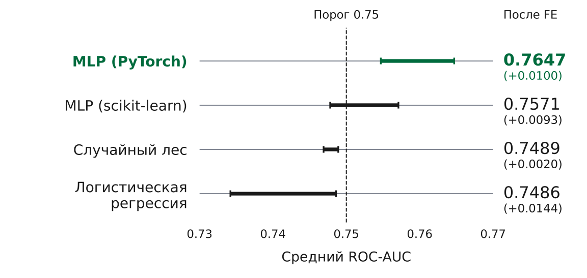
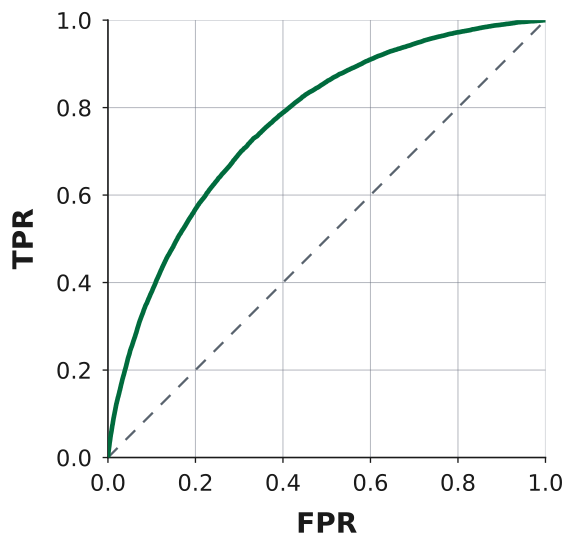

# Оценка кредитного риска

Модель для оценки кредитного риска по истории кредитных продуктов клиента. Бинарная классификация: `flag = 1` соответствует дефолту.

**ROC-AUC на тестовой выборке — 0.766 при требовании не ниже 0.75.**

Итоговый проект курса **Machine Learning** (Skillbox). Полное исследование представлено в ноутбуке [ml_final_project.ipynb](ml_final_project.ipynb).

## Данные

Исходный набор содержит **26 162 717 записей о кредитных продуктах для 3 000 000 заявок**. Доля положительного класса — **3.55%**.

Каждая запись описывает один кредитный продукт. Признаки агрегируются по заявке `id`; `rn` задаёт порядок продуктов в кредитной истории. В базовом представлении получено 409 признаков.

Исходные данные учебного курса недоступны для скачивания. В ноутбуке сохранены результаты расчётов; для проверки готового пайплайна приложен пример агрегированных данных.

## Что сделано

- Исследованы структура данных, пропуски, дубликаты и категории признаков.
- Сравнены логистическая регрессия, линейный SVC, случайный лес, `MLPClassifier` и собственный многослойный перцептрон в PyTorch.
- Реализован `TorchMLPClassifier` с интерфейсом scikit-learn, обучением на CPU/GPU, взвешиванием классов и ранней остановкой по ROC-AUC с восстановлением лучших весов.
- Проверены варианты агрегации кредитной истории. Выбраны веса `rn / sum(rn)`, преобразование `log1p(credit_count)` и количества уникальных категорий.
- Формирование дополнительных признаков, масштабирование и модель объединены в `Pipeline`. После оценки качества пайплайн обучен на всех данных, сохранён и проверен после загрузки.

## Валидация

Заявки разделены на обучающую и тестовую выборки в соотношении **80/20 со стратификацией**. Сравнение моделей и подбор гиперпараметров проведены на обучающей выборке.

Для сравнения использована **3-кратная стратифицированная кросс-валидация**. Первичный поиск по сетке выполнен на одном стратифицированном разбиении с последующей проверкой выбранных параметров на трёх фолдах. Финальный поиск проведён на трёх фолдах.

Тестовая выборка использована один раз для оценки выбранной модели.

## Результаты

### Влияние конструирования признаков

Отрезки показывают средний ROC-AUC на трёх фолдах до и после конструирования признаков (FE) для настроенных моделей.



Перцептрон в PyTorch сохранил преимущество. Конструирование признаков повысило его средний ROC-AUC с **0.755 до 0.765**, финальная настройка — до **0.766**.

Итоговые гиперпараметры: `hidden_layer_sizes=(128, 64)`, `learning_rate=0.0005`, `weight_decay=0.0001`, активация `ReLU`. Использованы взвешивание классов и ранняя остановка с `patience=3`.

### Оценка на тестовой выборке

**ROC-AUC — 0.766. Требование задания выполнено.**



## Проверка сохранённого пайплайна

Ноутбук `pipeline_check.ipynb` в папке `pipeline_check` проверяет совпадение предсказаний для 1000 заявок до и после сохранения пайплайна (`np.allclose`). Ожидаемый результат — `True`.

В той же папке должны находиться:

- `credit_risk_pipeline.pkl` — обученный пайплайн;
- `X_check.pq` — агрегированные признаки;
- `predict_proba_check.npy` — сохранённые предсказания.

На вход пайплайна подаются признаки, агрегированные по схеме подраздела 4.1 основного ноутбука.

Проверка выполнена на CPU в Python 3.12. Зависимости — в `requirements.txt`.

```bash
pip install -r requirements.txt  # при необходимости
```

## Файлы

- `ml_final_project.ipynb` — исследование с кодом и сохранёнными результатами.
- `pipeline_check/` — демонстрационный ноутбук, обученный пайплайн и файлы для проверки предсказаний.
- `requirements.txt` — зависимости.
- `images/` — графики для README.
- `.gitignore` — исключение служебных копий Jupyter.
